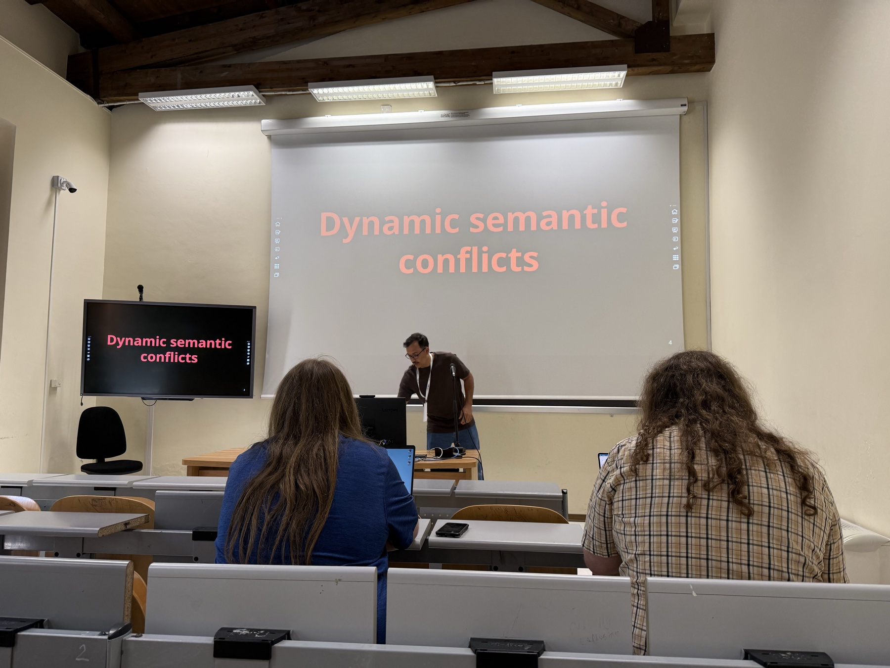
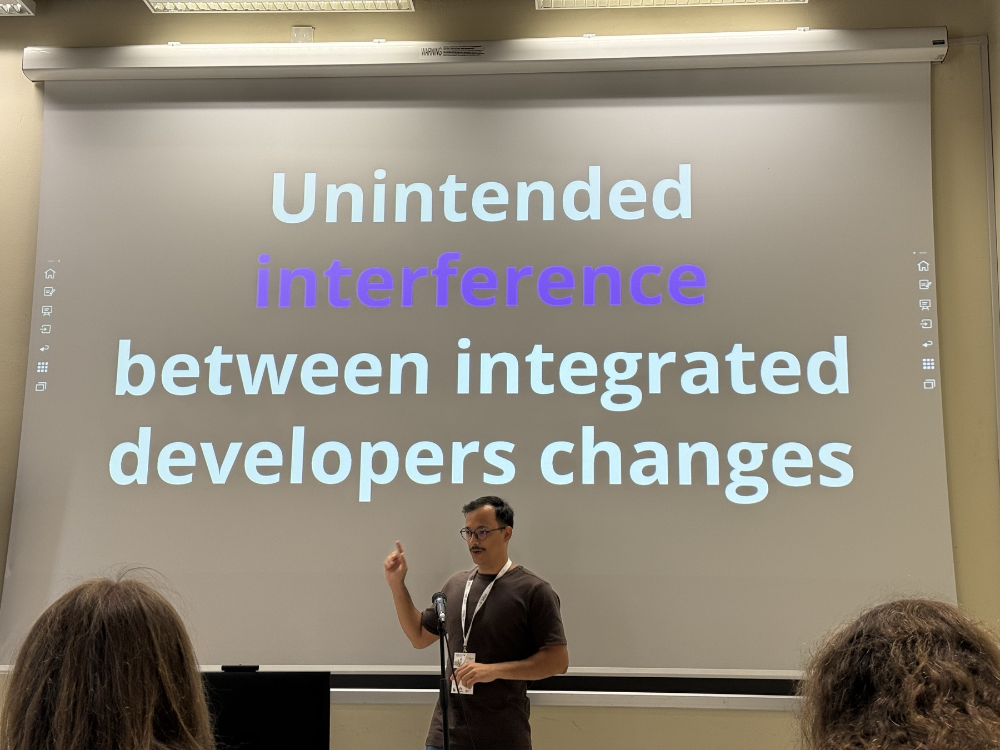
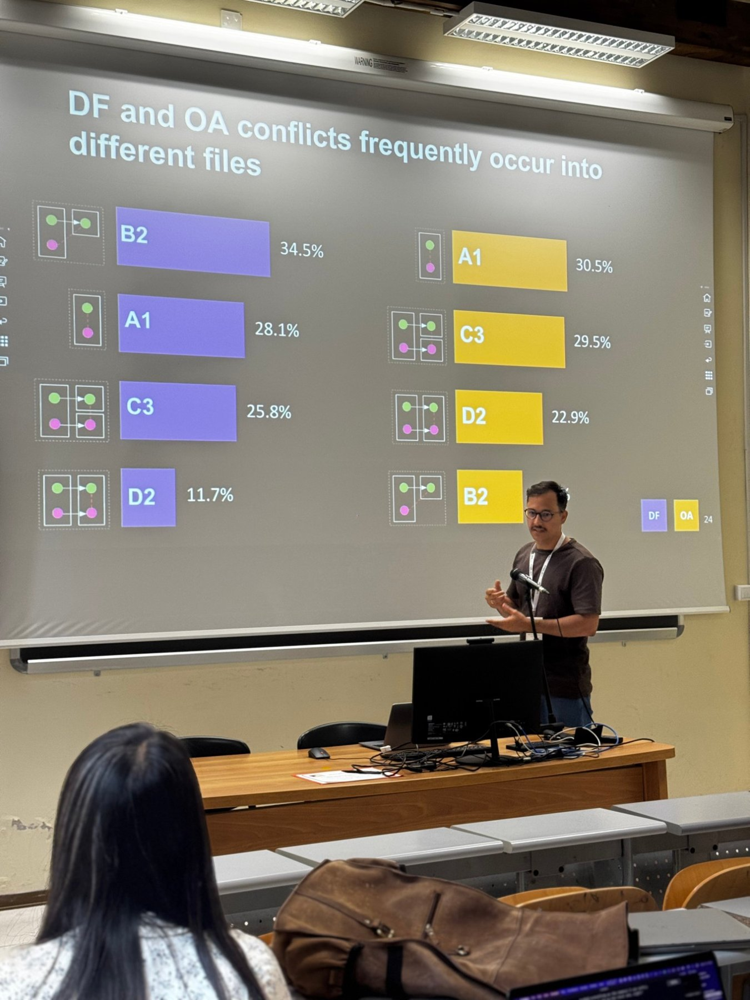
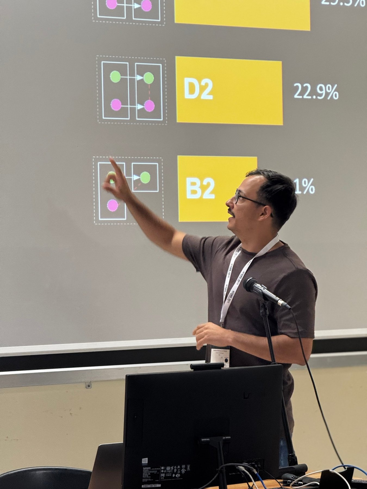
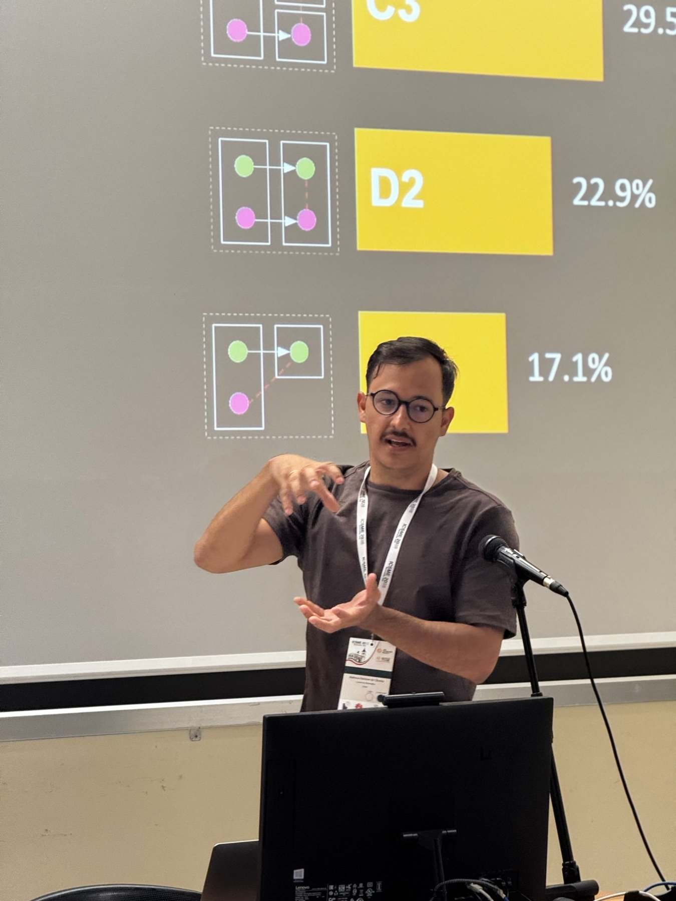
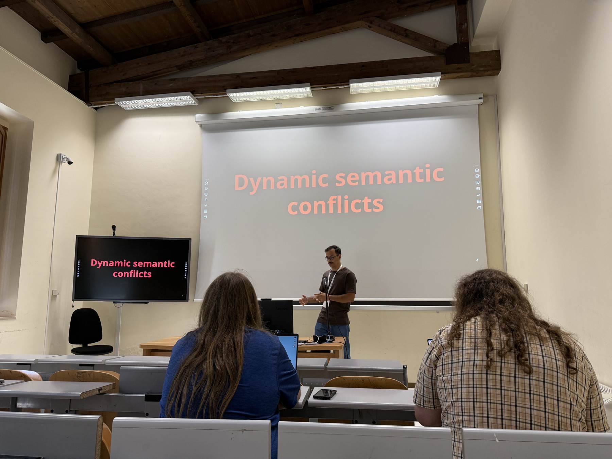

I presented our paper **A Quantitative Characterization of Semantic Conflicts in Open-Source Java Projects** at the SCAM 2026 Research Track, co-located with ICSME 2026 in Benevento, Italy.

  
  
  
  
  
  

