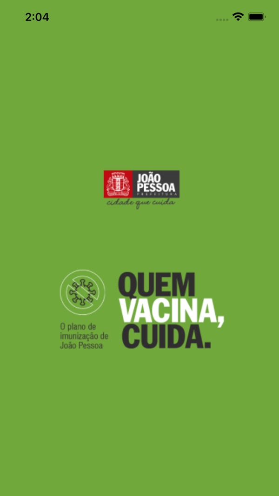
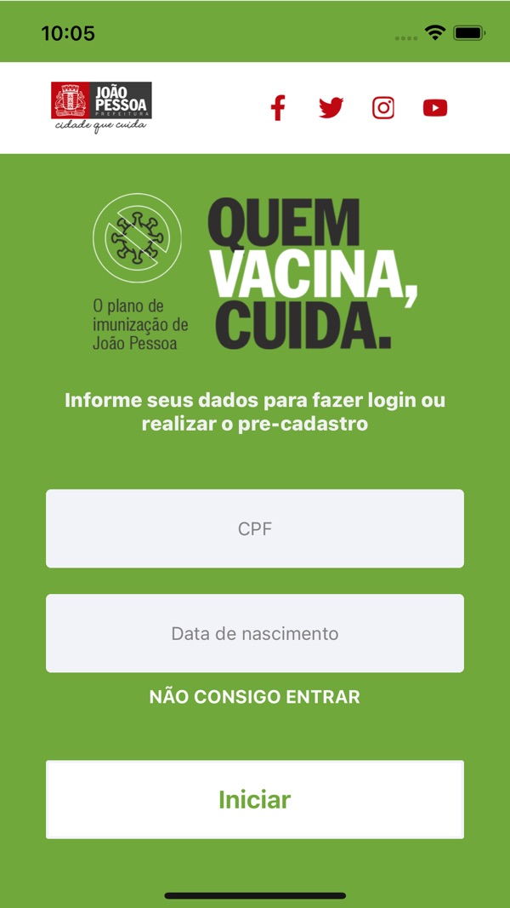
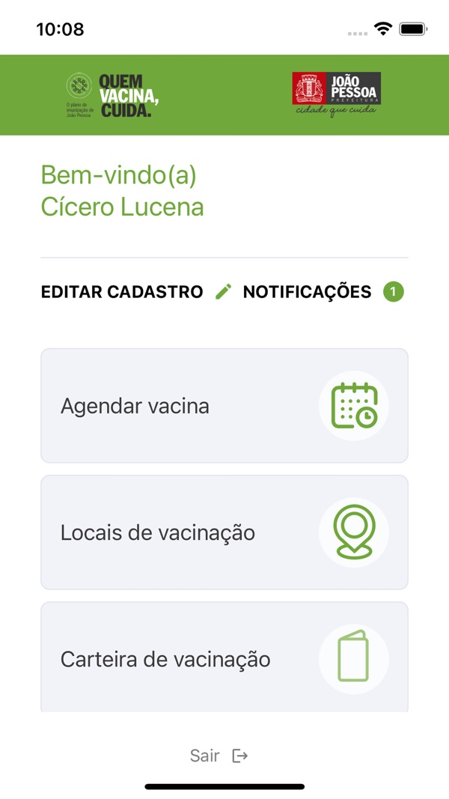
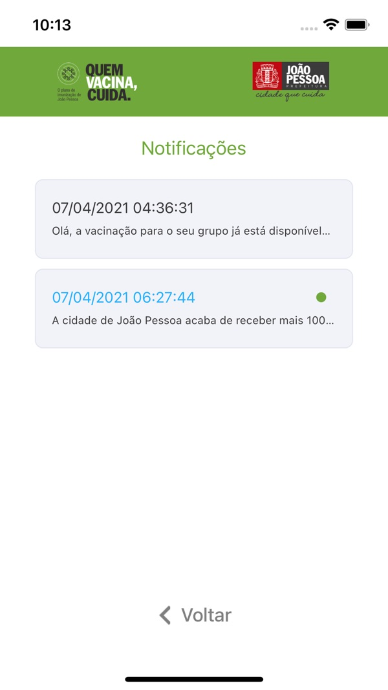

As coordinator of the mobile development team at [Cubo Tecnologia](https://www.cubotecnologiabr.com.br), I led the development of a suite of COVID-19 vaccination apps for municipalities in Paraíba, Brazil: **Vacina João Pessoa**, **Vacina Conde** and **Vacina Campina Grande**. The apps allowed citizens to pre-register, schedule their vaccination, find vaccination sites and access their digital vaccination card.

<!--more-->

The apps were the official channels for scheduling COVID-19 vaccination in these cities during the 2021–2022 campaigns, alongside the municipalities' websites.

  
  
  
  

*Developed by [Cubo Tecnologia](https://www.cubotecnologiabr.com.br).*
