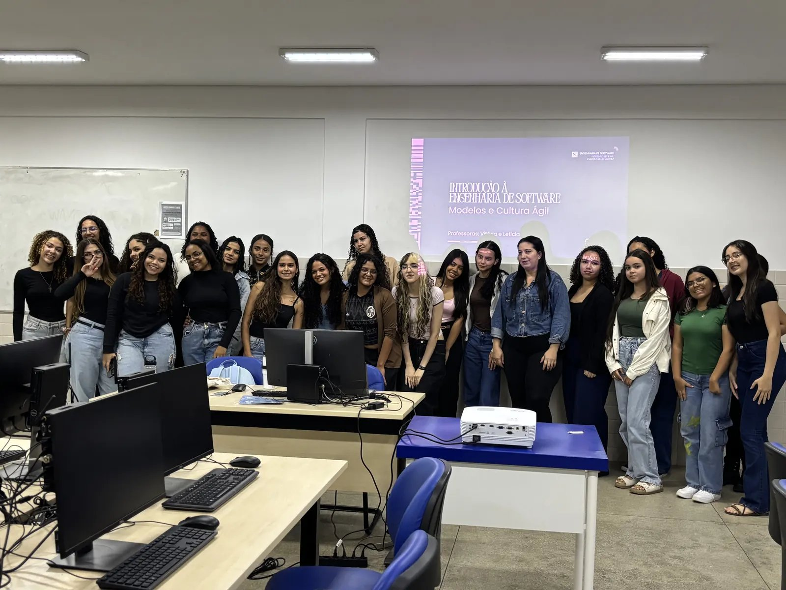
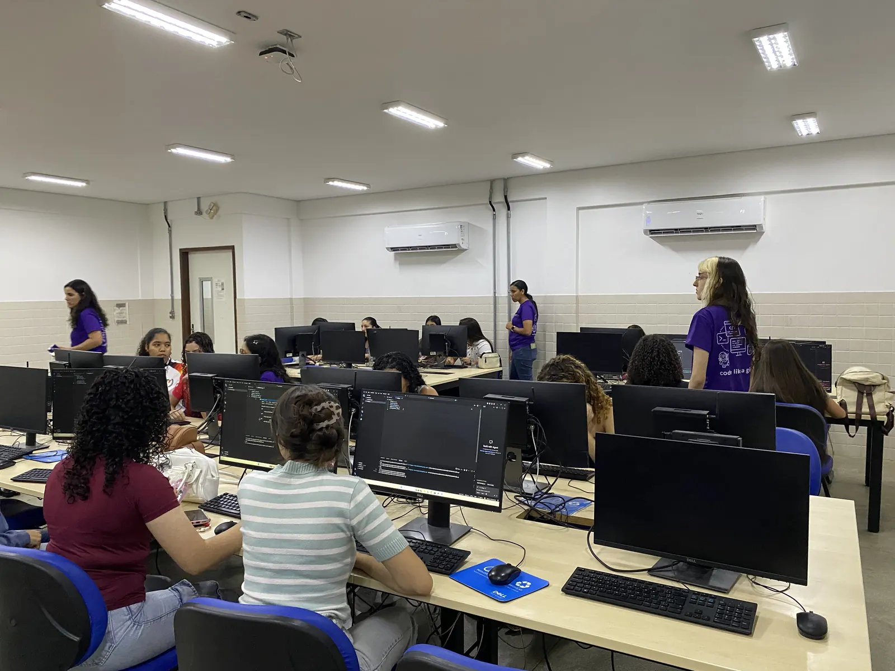
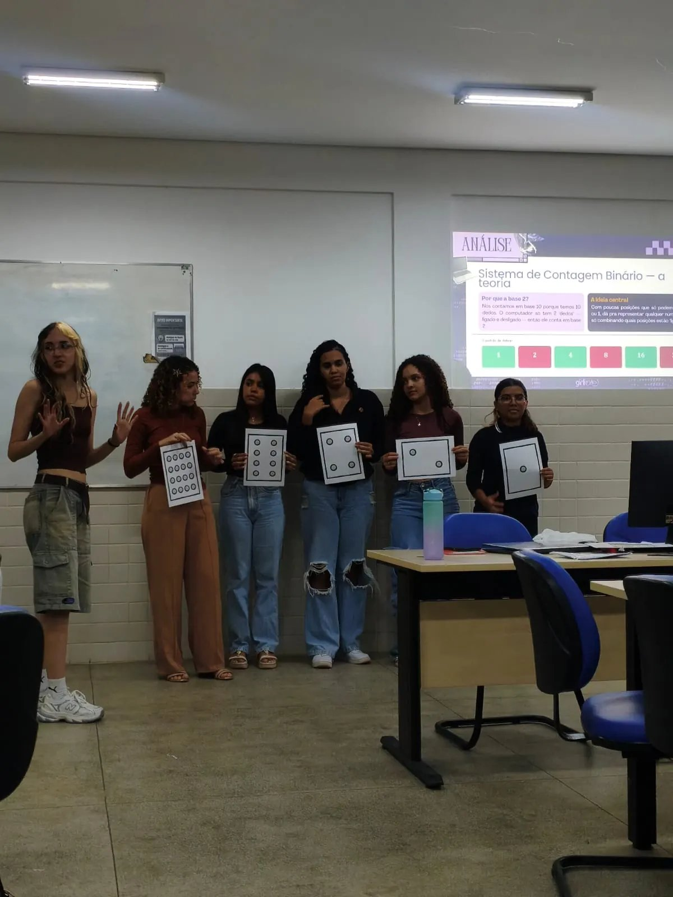

GirliES (Girls in Software Engineering) is an extension project of the Software Engineering program at the Federal Institute of Pernambuco (IFPE), Campus Belo Jardim, which I coordinate. It aims to bring girls from local high schools into technology through a free introductory course on Software Engineering and Programming Logic, combined with hands-on maker activities (2D and 3D modeling) and affirmative-action quotas.

<!--more-->

The project was born from senior Software Engineering students who experienced the beginning of the program as a minority in the classroom and decided to open the way for those who come next. The 42-hour leveling course covers Software Engineering, Discrete Mathematics and Systems, Programming Logic, Introduction to Python, and Algorithms and Data Structures, and is taught by the senior students, who also act as mentors. GirliES also promotes welcoming events each semester together with the campus inclusion centers (NEGED and NEABI), a continuous peer-mentoring network, and outreach through social media and institutional events such as the National Science and Technology Week (SNCT).

GirliES was ranked **10th in Brazil** in the SETEC/MEC 2026 call for extension projects on access, retention and success in the Federal Network.

  
  
  

## Team

- **Coordinator:** Matheus Barbosa
- **Instructors:** Maria Letícia (Lets), Rayssa Vitória (Raya), Lívia, Isadora and Vitória Melo
- **Volunteers:** Brenda, Eviny, Alexia, Edivone, Cecília, Isabela and Típhane

With the support of NEGED and NEABI at IFPE Campus Belo Jardim.
